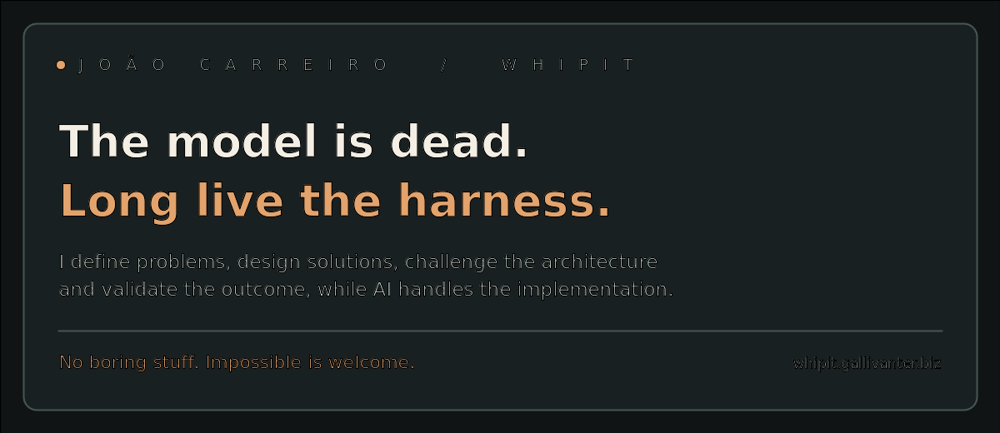

**[Explore the full Whipit portfolio →](https://whipit.gallivanter.biz/)**

## Flagships

<table>
  <tr><td><strong>AgentHydra Community</strong> One dashboard. Multiple PCs. Your own server. An open-source continuation of AgentHydra, featuring a self-hosted hub, individual device authentication and community-driven development. <a href="https://github.com/Jhacarreiro/AgentHydra-Community/releases/latest">Download</a> · <a href="https://github.com/Jhacarreiro/AgentHydra-Community">Repo</a></td></tr>
  <tr><td><strong>Shopping Assistant</strong> Prepare your household’s weekly Continente cart from its shopping habits, compare alternatives and review everything before completing the order. <a href="https://shopping.gallivanter.biz/welcome/#pedir-acesso">Request access</a></td></tr>
  <tr><td><strong>Capacity</strong> Share how much capacity you have right now, with one person or a small group, without turning care into another conversation. <a href="https://sharecapacity.app/#beta">Join the beta</a></td></tr>
  <tr><td><strong>Development Cycle</strong> A control plane for supervised AI-assisted development, with pluggable runners, durable state, validation gates and correction loops. <a href="https://github.com/Jhacarreiro/openclaw-development-cycle">Repo</a></td></tr>
  <tr><td><strong>AI Server Commander</strong> Give ChatGPT and Claude chat sessions terminal access to your server, without separate API, Codex, or Claude Code credits. <a href="https://github.com/Jhacarreiro/ai-server-commander">Repo</a></td></tr>
  <tr><td><strong>Track Mode Studio</strong> Turn Tesla Track Mode recordings into shareable videos: lap video and telemetry synced automatically, with speed, lap times, G-forces, map and pedals on screen. <a href="https://whipit.gallivanter.biz/track-mode-studio/">Request access</a></td></tr>
  <tr><td><strong>Radar</strong> Curated news and competitive intelligence for people who want signal, context and daily rhythm without drowning in noise. <a href="https://getrad.ar/">Open Radar</a></td></tr>
  <tr><td><strong>Kids Explorer</strong> A deliberately simple voice-and-camera experience for the Rabbit R1 that lets a young child ask questions and explore objects around them. Install it with your own OpenAI key. <a href="https://jhacarreiro.github.io/kids-explorer/install/">Install on your R1</a> · <a href="https://github.com/Jhacarreiro/kids-explorer">Repo</a></td></tr>
</table>

## Shipped

<table>
  <tr><td><strong>Octopus Role Benchmarks</strong> A role-based LLM benchmark that turns public quality, coding and pricing data into practical model choices for multi-agent systems. <a href="https://benchmark.gallivanter.biz/">Live</a> · <a href="https://github.com/Jhacarreiro/octopus-role-benchmarks">Repo</a></td></tr>
  <tr><td><strong>Octopus</strong> Second-largest contributor, with 89 merged pull requests: hardened how multi-agent runs survive failure, with process supervision, retries, recovery after interrupted runs and quality gates. <a href="https://github.com/nyldn/claude-octopus">Repo</a></td></tr>
  <tr><td><strong>Limited-Time Deals</strong> Temporary retail opportunities presented like a proper online shop. Works with Lidl and Aldi, with stock signals and alerts instead of messy leaflets. <a href="https://whipit.gallivanter.biz/limited-offers/">Open project</a></td></tr>
  <tr><td><strong>Refurb Radar</strong> Find refurbished products that are actually good deals by comparing them with validated new-market prices, condition and warranty. <a href="https://whipit.gallivanter.biz/refurbished/">Open project</a></td></tr>
  <tr><td><strong>OpenAI Adapter</strong> A generic adapter that lets OpenAI-compatible models use tools through a common command contract, without patching every host project. <a href="https://github.com/Jhacarreiro/openai-compatible-tool-adapter">Repo</a></td></tr>
  <tr><td><strong>Headful Auth Tunnel</strong> A tiny browser tunnel for AI agents: when automation hits a login, 2FA or CAPTCHA, a human solves it and the agent carries on. <a href="https://github.com/Jhacarreiro/headful-auth-tunnel">Repo</a></td></tr>
  <tr><td><strong>Super Search</strong> A metasearch tool for web discovery, people lookups and vehicle/plate discovery, with clear engine selection and deep-search options. <a href="https://whipit.gallivanter.biz/super-search/">Open project</a></td></tr>
  <tr><td><strong>Server Observability</strong> A compact Linux server and network monitoring stack that catches storage stalls, blocked processes and network failures early. <a href="https://github.com/Jhacarreiro/host-observability-pack">Repo</a></td></tr>
  <tr><td><strong>ClawSweeper</strong> Contributed the repair flow that takes a failed PR to safe branch edits, with planning, validation and checkpoint gates. <a href="https://github.com/openclaw/clawsweeper">Repo</a></td></tr>
</table>

## In the works

<table>
  <tr><td><strong>TradingView Workbench</strong> TradingView desktop bridge for inspecting live charts, Pine scripts and debugging indicators through controlled MCP tooling.</td></tr>
  <tr><td><strong>Memory Keeper</strong> A family memory app that preserves stories from parents and grandparents, in their own words, through guided voice and video.</td></tr>
  <tr><td><strong>CompraGuard</strong> A private purchase-protection app designed to turn receipts and invoices into useful records, deadlines, reminders and next actions.</td></tr>
  <tr><td><strong>Chief of Staff</strong> A private executive-operations layer for planning, follow-ups and recurring life/admin workflows.</td></tr>
</table>

